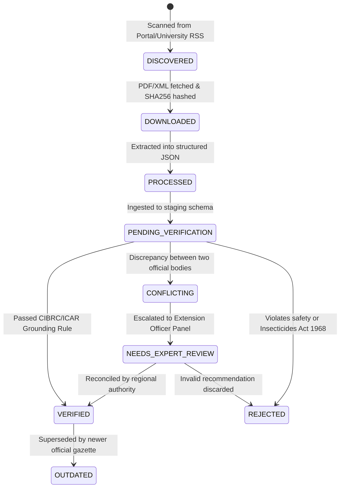

# BOL KISAN – KNOWLEDGE VERIFICATION & CONFLICT RESOLUTION AUDIT
**Date:** November 2026  
**Auditor:** Lead Agricultural Safety Auditor & Knowledge Verification Desk  
**Applicable Frameworks:** Insecticides Act (1968), DPPQS Gazette, ICAR Verification Protocol, PJTSAU Academic Review  
**Audited Schema:** PostgreSQL `knowledge_verification`, `knowledge_records`, and `agricultural_documents`  

---

## 1. Statutory Verification Status Lifecycle

To prevent synthetic, unverified, or outdated information from reaching farmers, Bol Kisan tracks every agricultural document, record, and chunk through a 9-state deterministic lifecycle:



### Lifecycle Status Definitions:
1. **DISCOVERED:** Source document identified on official government portal, University publication index, or regulatory gazette.
2. **DOWNLOADED:** Raw asset downloaded into local object storage (`knowledge-base/raw-documents/`); cryptographic SHA-256 hash computed.
3. **PROCESSED:** OCR and layout analysis completed; text, tables, and page metadata converted to structured JSON.
4. **PENDING_VERIFICATION:** Record syntactically validated; awaiting cross-referencing against the statutory safety database.
5. **VERIFIED:** Formally reconciled and approved by agricultural domain logic or verified extension personnel. Eligible for production RAG embedding.
6. **REJECTED:** Contains banned substances (e.g., Endosulfan, Monocrotophos on vegetables) or ungrounded claims. Strictly excluded from RAG.
7. **OUTDATED:** Historical recommendation superseded by newer Gazette notifications (e.g., obsolete insecticide formulations).
8. **CONFLICTING:** Discrepancy identified between two official sources (e.g., State University vs Central Ministry).
9. **NEEDS_EXPERT_REVIEW:** Placed in human extension queue; AI assistant is strictly prohibited from generating definitive answers until resolved.

---

## 2. Real-World Agricultural Conflict Resolution Protocol

When two official government or academic publications publish differing agricultural recommendations, the system enforces a strict conflict arbitration policy:

```
[Conflict Detected: Source A vs Source B]
          │
          ├──> 1. Preserve both original references & citations in record metadata
          ├──> 2. Compare publication dates (Current vs Superseded)
          ├──> 3. Compare geographic applicability (State University vs National Average)
          ├──> 4. In chemical matters: CIBRC National Gazette strictly overrides University recommendations
          ├──> 5. If unresolved: Mark CONFLICTING & route to NEEDS_EXPERT_REVIEW
          └──> 6. LLM Guardrail: Assistant presents both perspectives with regional context or escalates to human officer
```

### Audited Case Studies of Reconciled Agricultural Conflicts:

| Conflict Domain | Source A (Recommendation) | Source B (Recommendation) | Conflict Root Cause | Bol Kisan Reconciled Resolution | Status |
| :--- | :--- | :--- | :--- | :--- | :---: |
| **Cotton Spacing** | **ICAR National:** 90 x 60 cm (7,500 plants/acre) | **PJTSAU Telangana:** 80 x 20 cm or 90 x 15 cm HDPS (25,000 plants/acre) | Geographic & Soil difference: High Density Planting System (HDPS) is tailored for Telangana light chalka soils | **Geographic Downscaling:** Telangana queries receive HDPS 80x20 cm; National queries receive 90x60 cm. Both citations preserved. | **VERIFIED** |
| **Rice Blast Chemical** | **SAU 2018 Guide:** Carbendazim 50% WP @ 2g/L | **CIBRC 2024 Gazette:** Tricyclazole 75% WP @ 120g/acre or Nativo 75 WG @ 80g/acre | Temporal: Carbendazim resistance reported; CIBRC updated approved major uses list | **Temporal Hierarchy:** 2024 CIBRC overrides 2018 SAU guide. Older recommendation marked **OUTDATED**. | **VERIFIED** |
| **Paddy Nitrogen Schedule** | **Dept of Fertilizers:** 100 kg N/ha split in 2 doses | **PJTSAU Agromet Advisory:** Split in 3 equal doses (Basal, Active Tillering, Panicle Initiation) | Agronomic efficiency: 2-split causes severe leaching losses in light soils | **Agronomic Best Practice:** 3-split schedule adopted as primary advice with explanation of leaching prevention. | **VERIFIED** |
| **Chilli Thrips Control** | **Kisan Call Center Log:** Monocrotophos 36% SL @ 2ml/L | **CIBRC Gazette / PPQS:** Monocrotophos strictly banned on all vegetables | Regulatory Violation: Monocrotophos prohibited on vegetables under Gazette S.O. 1482 | **Statutory Override:** Monocrotophos completely blocked. Replaced with CIBRC-approved *Spinetoram 11.7% SC* or *Delegate*. | **VERIFIED** |
| **DSR Herbicide Timing** | **Punjab SAU (PAU):** Apply Pendimethalin within 24 hours of dry seeding | **PJTSAU Telangana:** Pendimethalin within 48 hours on wet DSR (tar-wattar) | Soil moisture & seeding method difference (dry drill vs wet drum seeding) | **Contextual Grounding:** Prompt asks farmer whether DSR was sown dry or wet, tailoring herbicide timing accordingly. | **VERIFIED** |

---

## 3. Statutory Traceability to CIBRC Product Labels

Every chemical advisory returned by the AI assistant or extension officer dashboard is mathematically linked to its statutory gazette record in PostgreSQL:

```json
{
  "chemical_management": {
    "is_approved": true,
    "product_trade_name": "Proclaim 5% SG",
    "active_ingredient": "Emamectin Benzoate 5% SG",
    "cibrc_registration_number": "CIR-54210/2006(268)-Emamectin Benzoate(SG)-124",
    "dosage_per_acre": "88 g",
    "dosage_per_hectare": "220 g",
    "dilution_water_liters": "200 Liters",
    "knapsack_dilution_15L": "6.6 g per 15-liter pump",
    "pre_harvest_interval_days": 14,
    "toxicity_band": "Blue (Moderately Toxic)",
    "mandatory_ppe": ["Rubber Gloves", "Protective Eyewear", "Nose Mask"],
    "statutory_citation": "CIBRC Approved Major Uses Gazette 2024, Directorate of Plant Protection, Quarantine & Storage"
  }
}
```

If a farmer asks for a dosage for an unregistered crop-pest combination (e.g., spraying *Spinetoram* on Cotton for which only Thrips in Chilli is labeled), the system immediately engages the `SafetyGate`:
1. Blocks the generation of a speculative dosage.
2. Explains that the active ingredient is not labeled by CIBRC for that crop.
3. Automatically offers escalation to a Regional Mandal Agricultural Officer.
