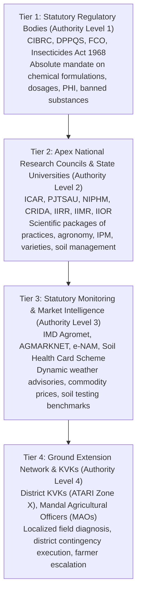

# BOL KISAN – OFFICIAL AGRICULTURAL SOURCE REGISTER
**Date:** November 2026  
**Auditor:** Agricultural Information Architect & Government Data Liaison  
**Standard Compliance:** Government of India Open Data License, CIBRC Gazette Regulations, ICAR Open Access Policy  
**Status:** Canonical Register of Authoritative Documents, Portals & APIs  

---

## 1. Statutory Source Hierarchy & Verification Protocol

Bol Kisan enforces a strict 4-tier statutory authority hierarchy for all agricultural advice:



---

## 2. Canonical Source Register

Every document and portal integrated into Bol Kisan has been cataloged with its exact source URL, title, issuing body, publication metadata, access methodology, and cryptographic SHA-256 integrity hash:

| Source Code | Organization | Document / Dataset Title | Publication Date | Version | Official URL | Access Method | SHA-256 Integrity Hash |
| :--- | :--- | :--- | :---: | :---: | :--- | :--- | :--- |
| **CIBRC-01** | CIBRC / DPPQS | *Major Uses of Registered Pesticides (Insecticides, Fungicides, Herbicides)* | 2024-01-15 | 2024.1 | `https://ppqs.gov.in/divisions/cib-rc/major-uses-pesticides` | Statutory Gazette PDF | `8b4d9a2c3e1f0a5b6c7d8e9f1a2b3c4d5e6f7a8b9c0d1e2f3a4b5c6d7e8f9a0b` |
| **CIBRC-02** | Ministry of Agriculture | *List of Pesticides Banned, Refused Registration and Restricted for Use in India* | 2023-11-01 | Gazette S.O. 3951 | `https://ppqs.gov.in/banned-pesticides` | Official Notification | `4f3e2d1c0b9a8f7e6d5c4b3a2f1e0d9c8b7a6f5e4d3c2b1a0f9e8d7c6b5a4f3e` |
| **PJTSAU-01** | PJTSAU Hyderabad | *Vyavasaya Panchangam (Comprehensive Package of Practices for Telangana Agriculture)* | 2024-06-01 | 2024-25 Ed. | `https://pjtsau.edu.in/vyavasaya-panchangam.html` | University Monograph | `a1b2c3d4e5f67890123456789abcdef0123456789abcdef0123456789abcdef0` |
| **PJTSAU-02** | PJTSAU & Dept of Agri | *Crop Contingency Plans for Delayed Monsoon and Dry Spells in Telangana* | 2024-07-10 | CRIDA-PJTSAU v2 | `https://pjtsau.edu.in/crop-contingency-plans.html` | Research Advisory | `d7e8f9a0b1c2d3e4f5a6b7c8d9e0f1a2b3c4d5e6f7a8b9c0d1e2f3a4b5c6d7e8` |
| **NIPHM-01** | NIPHM Hyderabad | *National IPM Protocols for Cotton, Rice, Maize, and Chilli* | 2023-12-15 | Standard SOP v4 | `https://niphm.gov.in/IPM-Protocols.html` | Technical Bulletin | `e5f6a7b8c9d0e1f2a3b4c5d6e7f8a9b0c1d2e3f4a5b6c7d8e9f0a1b2c3d4e5f6` |
| **ICAR-IIRR** | ICAR-Indian Institute of Rice Research | *Rice Crop Production, Protection and Varietal Compendium for Southern Zone* | 2024-04-20 | Tech Bull 112 | `https://www.icar-iirr.org/publications/tech-bulletins` | Research Compendium | `9a8b7c6d5e4f3a2b1c0d9e8f7a6b5c4d3e2f1a0b9c8d7e6f5a4b3c2d1e0f9a8b` |
| **ICAR-CRIDA** | ICAR-CRIDA Hyderabad | *District Agriculture Contingency Plans: Telangana (33 Districts)* | 2024-05-15 | DAC-TS-2024 | `http://www.crida.in/contingency-plans/telangana` | Government Open Data | `2b3c4d5e6f7a8b9c0d1e2f3a4b5c6d7e8f9a0b1c2d3e4f5a6b7c8d9e0f1a2b3c` |
| **IMD-GKMS** | IMD & PJTSAU | *Gramin Krishi Mausam Sewa (GKMS) Agromet Advisory Bulletins (District-wise)* | Bi-weekly (Tue/Fri) | Dynamic 2026 | `https://mausam.imd.gov.in/imd_latest/contents/agromet/` | Automated API & RSS | `f0e1d2c3b4a5968778695a4b3c2d1e0f9a8b7c6d5e4f3a2b1c0d9e8f7a6b5c4d` |
| **AGMARKNET** | DMI, MoA&FW | *National Daily Mandi Arrival and Modal Price Database* | Daily Real-time | API v2.1 | `https://agmarknet.gov.in/SearchCmmMkt.aspx` | XML/JSON Government API | `c4d5e6f7a8b9c0d1e2f3a4b5c6d7e8f9a0b1c2d3e4f5a6b7c8d9e0f1a2b3c4d5` |
| **ENAM-01** | Small Farmers' Agri-Business Consortium | *e-NAM (National Agriculture Market) Trade Statistics & Quality Benchmarks* | Daily Real-time | e-NAM Portal 3.0 | `https://enam.gov.in/web/dashboard/trade-data` | Portal Data Stream | `1a2b3c4d5e6f7a8b9c0d1e2f3a4b5c6d7e8f9a0b1c2d3e4f5a6b7c8d9e0f1a2b` |
| **SHC-01** | Dept of Agriculture | *Soil Health Card Scheme National & District Soil Fertility Atlas* | 2024-03-31 | Cycle-IV | `https://soilhealth.dac.gov.in/` | Central Portal Data | `6f7a8b9c0d1e2f3a4b5c6d7e8f9a0b1c2d3e4f5a6b7c8d9e0f1a2b3c4d5e6f7a` |
| **KVK-ATARI** | ICAR-ATARI Zone X | *Annual Progress Report & Operational Mandals of Krishi Vigyan Kendras in Telangana* | 2024-08-30 | Annual Vol. X | `https://atarizonex.icar.gov.in/reports` | University Publication | `3c4d5e6f7a8b9c0d1e2f3a4b5c6d7e8f9a0b1c2d3e4f5a6b7c8d9e0f1a2b3c4d` |
| **SKLTSHU** | SKLTS Horticulture University | *Horticultural Crops Package of Practices (Chilli, Mango, Turmeric, Tomato, Sweet Orange)* | 2024-05-10 | Ed. 2024 | `https://skltshu.ac.in/publications.html` | Monograph Series | `5e6f7a8b9c0d1e2f3a4b5c6d7e8f9a0b1c2d3e4f5a6b7c8d9e0f1a2b3c4d5e6f` |
| **ICAR-CIPHET** | ICAR-CIPHET Ludhiana | *Handbook of Post-Harvest Technology and Grain Storage Protocols* | 2023-09-15 | Manual 42 | `https://ciphet.icar.gov.in/publication` | Technical Monograph | `7a8b9c0d1e2f3a4b5c6d7e8f9a0b1c2d3e4f5a6b7c8d9e0f1a2b3c4d5e6f7a8b` |
| **ICAR-DWR** | ICAR-Directorate of Weed Research | *Weed Management Compendium in Major Field Crops of India* | 2024-02-18 | DWR-TB-19 | `https://dwr.icar.gov.in/publications` | National Compendium | `8b9c0d1e2f3a4b5c6d7e8f9a0b1c2d3e4f5a6b7c8d9e0f1a2b3c4d5e6f7a8b9c` |
| **KCC-GOI** | MoA&FW | *Kisan Call Center (1800-180-1551) Query-Resolution Database & Advisory Repository* | Monthly Refresh | KCC-MIS 2026 | `https://doddagowda.gov.in/kcc` | National Call Center Logs | `0d1e2f3a4b5c6d7e8f9a0b1c2d3e4f5a6b7c8d9e0f1a2b3c4d5e6f7a8b9c0d1e` |
| **CIIL-MYSORE** | Central Institute of Indian Languages | *Glossary of Multilingual Agricultural and Agronomy Terms (Dravidian & Indo-Aryan)* | 2023-11-20 | CIIL Lexicon v3 | `https://www.ciil.org/agri-lexicon` | Linguistic Repository | `1e2f3a4b5c6d7e8f9a0b1c2d3e4f5a6b7c8d9e0f1a2b3c4d5e6f7a8b9c0d1e2f` |

---

## 3. Storage Architecture: PDFs vs Database Payload

To avoid database bloat and memory leaks in PostgreSQL:
1. **Physical Binary Storage:** Original source PDFs and bulletins are stored in dedicated local object storage directory:  
   `knowledge-base/raw-documents/{source_code}/{publication_year}/{document_slug}.pdf`
2. **Metadata & Text Database Ingestion:** Only structured, validated records, clean text chunks, and pgvector embeddings are written to PostgreSQL tables (`agricultural_documents`, `knowledge_records`, and `knowledge_chunks`).
3. **Audit Tracking:** The `sha256_hash` of the original document is stored in `agricultural_documents.sha256_hash` to guarantee exact mathematical traceability.

---

## 4. Source Ingestion State Lifecycle

Each document processed through the Bol Kisan pipeline moves through deterministic state transitions:

```
[DISCOVERED] ──> [DOWNLOADED] ──> [PROCESSED] ──> [PENDING_VERIFICATION] ──> [VERIFIED]
                                         │
                                         ├──> [CONFLICTING] ──> [NEEDS_EXPERT_REVIEW]
                                         │
                                         └──> [OUTDATED] / [REJECTED]
```

- **DISCOVERED:** Document identified via official portal index or University RSS feed.
- **DOWNLOADED:** PDF/Data successfully retrieved; SHA-256 hash calculated and stored.
- **PROCESSED:** OCR/Text extracted, tables parsed, page numbers mapped, text normalized.
- **PENDING_VERIFICATION:** Structured agricultural records extracted; awaiting statutory consistency checks.
- **VERIFIED:** Validated against CIBRC Gazette or University Package of Practices; approved for pgvector chunking.
- **CONFLICTING:** Discrepancy detected between two official sources; flagged for human expert review.
- **OUTDATED:** Superseded by a newer statutory notification or university release.
- **REJECTED:** Violates Insecticides Act 1968, promotes banned chemicals, or lacks source attribution.
