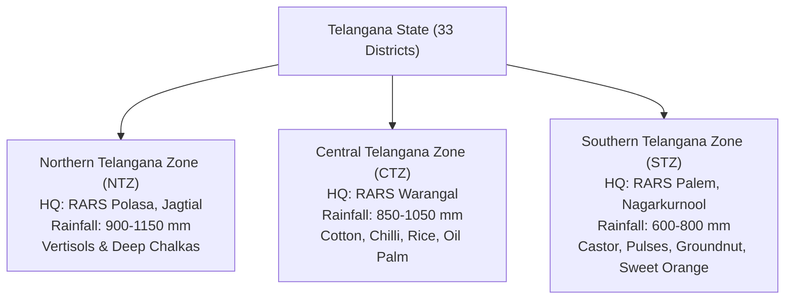

# BOL KISAN – TELANGANA-FIRST AGRICULTURAL COVERAGE & REGIONAL REPOSITORY
**Date:** November 2026  
**Auditor:** Regional Agronomy & Telangana Agricultural University (PJTSAU) Knowledge Desk  
**Baseline Standard:** PJTSAU *Vyavasaya Panchangam*, RARS Regional Packages, and ICAR-CRIDA District Contingency Plans  
**Geographic Domain:** Telangana State (33 Revenue Districts across 3 Agro-Climatic Zones)  

---

## 1. Regional Overview & Agro-Climatic Zoning

Telangana spans an agricultural area of approximately 1.3 crore acres across semi-arid peninsular India. Agriculture is classified into three distinct Agro-Climatic Zones, each defined by distinct rainfall patterns, soil geology, cropping systems, and pest dynamics:



---

## 2. Comprehensive Zone-by-Zone Agronomic Master

### 2.1. Northern Telangana Zone (NTZ)
* **Headquarters & Research Station:** Regional Agricultural Research Station (RARS), Polasa, Jagtial.
* **Districts Covered (10):** Adilabad, Nirmal, Mancherial, Komaram Bheem Asifabad, Karimnagar, Jagtial, Peddapalli, Rajanna Sircilla, Nizamabad, Kamareddy.
* **Agro-Climatic Parameters:** High monsoon rainfall (900–1150 mm), moderate winter minimums (10–14°C).
* **Predominant Soils:** Deep Black Soils (Vertisols) along Godavari basin; Medium to shallow Red Chalkas on undulating terrain.
* **Priority Cropping Systems:**
  - *Soybean $\rightarrow$ Bengal Gram / Rabi Maize* (Nirmal, Adilabad, Kamareddy)
  - *Paddy $\rightarrow$ Paddy / Maize* (Nizamabad, Karimnagar, Peddapalli — canal command of SRSP)
  - *Turmeric (Pure / Intercropped with Maize)* (Nizamabad, Jagtial)
  - *Cotton (Pure / Intercropped with Red Gram 8:1)* (Adilabad, Asifabad)
  - *Mango Orchards* (Jagtial, Peddapalli — major export cluster)
* **University-Released Cultivars:**
  - **Rice:** *KNM 118 (Kunaram Sannalu)* — blast resistant; *RNR 15048 (Telangana Sona)* — low GI; *JGL 24423 (Jagtyala Sannalu)*.
  - **Turmeric:** *Armoor*, *Duggirala*, *Rajapore*, *PTS-10*.
  - **Soybean:** *JS 335*, *JS 93-05*, *KDS 726*.
* **Critical Regional Pests & Management:**
  - **Turmeric Rhizome Rot (*Pythium aphanidermatum*):** Soil drenching with Metalaxyl + Mancozeb @ 2.5 g/L or *Trichoderma viride* @ 2 kg mixed in 200 kg FYM.
  - **Soybean Girdle Beetle (*Oberereopsis brevis*):** Spray Thiamethoxam 12.6% + Lambda Cyhalothrin 9.5% ZC @ 60 ml/acre at initial twig wilting.
  - **Rice Gall Midge (*Orseolia oryzae*):** Resistant variety *KNM 118*; apply Chlorpyrifos 20% EC @ 2.5 ml/L at seedling stage.
* **Key KVKs & Research Hubs:**
  - KVK Jagtial (`08724-277274`)
  - KVK Rudrur, Nizamabad (`08467-284144`)
  - KVK Bellampalli, Mancherial (`08735-222123`)
  - KVK Jammikunta, Karimnagar (`08727-254245`)

---

### 2.2. Central Telangana Zone (CTZ)
* **Headquarters & Research Station:** Regional Agricultural Research Station (RARS), Warangal.
* **Districts Covered (8):** Warangal, Hanamkonda, Jangaon, Jayashankar Bhupalpally, Mulugu, Mahabubabad, Khammam, Bhadradri Kothagudem.
* **Agro-Climatic Parameters:** Moderate to high rainfall (850–1050 mm), hot semi-arid to sub-humid transitions.
* **Predominant Soils:** Deep black cotton soils, mixed red sandy soils, river alluvium along the Godavari and Munneru basins.
* **Priority Cropping Systems:**
  - *Bt Cotton (Rainfed & Supplemental Drip)* (Warangal, Jangaon, Mahabubabad)
  - *Teja Chilli (Intensive Commercial Cultivation)* (Khammam, Mahabubabad, Warangal)
  - *Paddy (Kharif $\rightarrow$ Rabi DSR or Groundnut)* (Hanamkonda, Bhupalpally, Mulugu)
  - *Oil Palm (State Mission Expansion)* (Bhadradri Kothagudem, Khammam — drip fertigated)
  - *Pulses (Black Gram / Green Gram as catch crops)* (Godavari floodplains)
* **University-Released Cultivars:**
  - **Chilli:** *Warangal Chappatta (Mild pungent, high color)*, *LCA 625*, *Teja (S17)*.
  - **Rice:** *WGL 44 (Siddi)*, *WGL 962*, *MTU 1010*, *BPT 5204 (Samba Mahsuri)*.
  - **Cotton:** *WGCV-48*, *PKV-081*, approved BG-II hybrids.
* **Critical Regional Pests & Management:**
  - **Invasive Black Thrips (*Thrips parvispinus*) in Chilli:** Devastating flower-infesting pest. Mandatory IPM: 4 border rows of maize or bajra; 30 blue sticky traps/acre; alternate spray with Spinetoram 11.7% SC @ 160 ml/acre and Broflanilide 300 SC @ 20 ml/acre. Avoid synthetic pyrethroids which induce flare-up.
  - **Pink Bollworm (*Pectinophora gossypiella*) in Cotton:** Install 8 pheromone traps/acre from 45 DAS; PB Rope mating disruption; spray Emamectin Benzoate 5% SG @ 88 g/acre or Chlorantraniliprole 18.5% SC @ 60 ml/acre at 10% rosette flower stage.
  - **Cotton Parawilt / Sudden Wilt in Heavy Black Soils:** Occurs when sudden heavy rains follow dry spell. Corrective root drenching within 24 hours: 10g Copper Oxychloride + 20g Urea per 10L water per plant.
* **Key KVKs & Research Hubs:**
  - KVK Malyal, Mahabubabad (`08719-240250`)
  - KVK Wyra, Khammam (`08749-251230`)
  - KVK Bhadradri Kothagudem (`08744-245100`)
  - KVK Ramagirikhilla (`08728-278120`)

---

### 2.3. Southern Telangana Zone (STZ)
* **Headquarters & Research Station:** Regional Agricultural Research Station (RARS), Palem, Nagarkurnool.
* **Districts Covered (12):** Mahabubnagar, Nagarkurnool, Wanaparthy, Jogulamba Gadwal, Narayanpet, Nalgonda, Suryapet, Yadadri Bhuvanagiri, Rangareddy, Vikarabad, Medchal-Malkajgiri, Hyderabad.
* **Agro-Climatic Parameters:** Low, erratic rainfall (600–800 mm), frequent 3-4 week mid-season dry spells, high potential evapotranspiration.
* **Predominant Soils:** Shallow Red Sandy Loams (Chalkas), Dubba soils, gravely skeletal soils; deep black soils restricted to Tungabhadra and Krishna basins (Gadwal, Alampur).
* **Priority Cropping Systems:**
  - *Castor (Sole / Intercropped with Red Gram 1:1)* (Mahabubnagar, Narayanpet)
  - *Red Gram (Medium duration dryland)* (Vikarabad — designated Red Gram GI hub)
  - *Sweet Orange / Mosambi Orchards* (Nalgonda, Suryapet)
  - *Cotton (Dryland & Micro-irrigated)* (Gadwal, Nagarkurnool)
  - *Rabi Groundnut (Under borewells)* (Wanaparthy, Gadwal)
  - *Pearl Millet / Jowar (Drought contingency)* (Mahabubnagar, Nalgonda)
* **University-Released Cultivars:**
  - **Castor:** *DCH-519*, *PCH-111*, *PCH-222*, *Jyothi*.
  - **Red Gram:** *PRG-176*, *WRG-65*, *Hanuma (WRG-53)*, *Asha (ICPL 87119)*.
  - **Groundnut:** *Kadiri 6 (K-6)*, *TAG-24*, *Dharani*.
  - **Sweet Orange:** *Batavian (Sathgudi)* on Rangpur Lime rootstock.
* **Critical Regional Pests & Management:**
  - **Castor Semilooper (*Achaea janata*):** Early instar defoliation. Spray *Bacillus thuringiensis* (Bt) @ 2 g/L or Profenofos 50% EC @ 2 ml/L when defoliation exceeds 25%.
  - **Red Gram Wilt (*Fusarium udum*) & Sterility Mosaic Disease (SMD):** Grow resistant cultivar *PRG-176*; rogue out SMD-infected pale-green bushy plants early; spray Fenazaquin 10% EC @ 2 ml/L against eriophyid mite vector (*Aceria cajani*).
  - **Sweet Orange Leaf Miner & Canker:** Foliar spray of Streptocycline @ 1g + Copper Oxychloride @ 30g per 10L water after flushing.
* **Key KVKs & Research Hubs:**
  - KVK Palem, Nagarkurnool (`08540-228646`)
  - KVK Kampasagar, Nalgonda (`08689-284855`)
  - KVK Gaddipally, Suryapet (`08683-242555`)
  - KVK CRIDA, Hayathnagar, Ranga Reddy (`040-24530177`)

---

## 3. District-Wise Priority Mapping Matrix

The table below catalogs priorities across key representative agricultural districts in Telangana:

| District | Zone | Soil Type Profile | Major Kharif Crops | Major Rabi Crops | Key Pests & Disease Threats | Local APMC Mandi Hub | Dedicated KVK Center |
| :--- | :---: | :--- | :--- | :--- | :--- | :--- | :--- |
| **Warangal** | CTZ | Deep Black Vertisol | Bt Cotton, Paddy | Teja Chilli, Maize | Pink Bollworm, Rice Blast | Enumamula (Warangal) | KVK Malyal |
| **Khammam** | CTZ | Alluvial / Red Sandy | Chilli, Cotton, Oil Palm | Maize, Black Gram | Invasive Black Thrips, Mites | Khammam Main Market | KVK Wyra |
| **Nizamabad** | NTZ | Clay Loam / Black Soil | Turmeric, Paddy, Soy | Bengal Gram, Sunflower | Rhizome Rot, Stem Borer | Nizamabad APMC | KVK Rudrur |
| **Jagtial** | NTZ | Red Sandy Loam (Chalka)| Mango, Cotton, Maize | Paddy, Sesamum | Mango Hopper, FAW | Jagtial APMC | KVK Polasa |
| **Nalgonda** | STZ | Sandy Clay / Saline | Cotton, Mosambi, Paddy | Groundnut, Pulses | Citrus Canker, BPH in Rice | Nalgonda / Miryalaguda | KVK Kampasagar |
| **Mahabubnagar**| STZ | Shallow Chalka & Dubba | Castor, Red Gram, Cotton | Rabi Groundnut | Semilooper, Red Gram Wilt | Badepally (Jadcherla) | KVK Palem |
| **Adilabad** | NTZ | Heavy Deep Black Soil | Cotton, Soybean, Red Gram | Bengal Gram, Wheat | Dahiya Disease, Girdle Beetle | Adilabad Cotton Market | KVK Adilabad |
| **Vikarabad** | STZ | Red Sandy / Lateritic | Tandur Red Gram (GI), Soy| Rabi Jowar, Safflower | Sterility Mosaic, Pod Borer | Tandur APMC | KVK Vikarabad |

---

## 4. Multi-State Expansion Blueprint

Having grounded Bol Kisan in Telangana-first empirical data, the identical 4-stage ingestion architecture scales to neighboring Indian agrarian states:

```
[State Selection] ──> [State Agricultural University SAU Partnership] ──> [Zonal Research Station Downscaling] ──> [Local Language Alignment]
       │                                     │                                              │                                    │
    Andhra Pradesh                        ANGRAU                                        RARS Nandyal, Tirupati                 Telugu Coastal/Rayalaseema
    Maharashtra                           MPKV / Dr. PDKV                               Vidarbha / Western Plain               Marathi Dialects
    Madhya Pradesh                        JNKVV / RVSKVV                                Malwa / Nimar Zone                     Hindi / Bundeli
    Punjab / Haryana                      PAU / CCS HAU                                 Central Plain / Semi-Arid              Punjabi / Hindi
```
