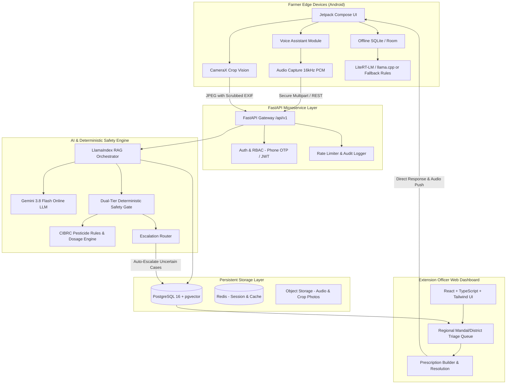
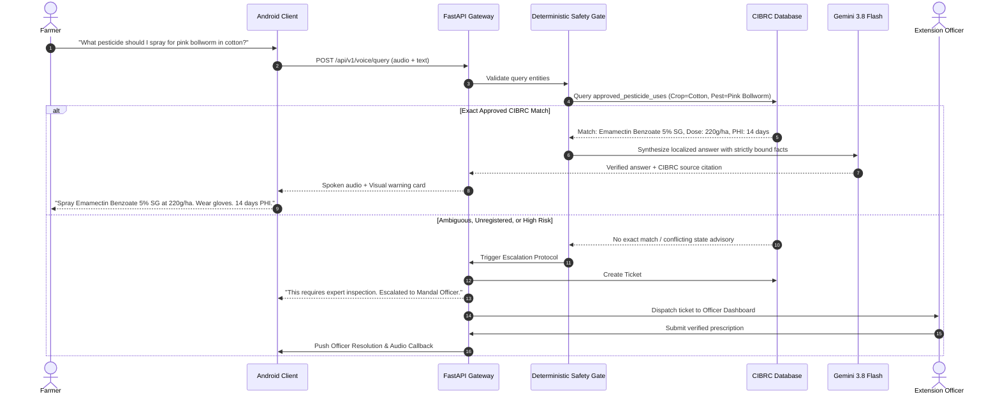

# Bol Kisan Architecture & System Specification

## 1. System Overview

Bol Kisan is a voice-first, multilingual agricultural intelligence platform designed for Indian farmers and agricultural extension officers. It operates under a strict safety mandate: **Never generate unsupported agricultural advice.**



---

## 2. Monorepo Structural Blueprint

```
innovasia/
├── apps/
│   ├── farmer-android/            # Kotlin, Jetpack Compose, Room, CameraX, WorkManager
│   │   ├── app/
│   │   │   ├── src/main/java/com/bolkisan/farmer/
│   │   │   │   ├── data/          # Room DB, API repositories, Local cache
│   │   │   │   ├── domain/        # Use cases, offline fallback rules, safety models
│   │   │   │   ├── presentation/  # Jetpack Compose UI (Screens, ViewModels, Themes)
│   │   │   │   │   ├── auth/      # Phone OTP login
│   │   │   │   │   ├── home/      # Farmer home screen
│   │   │   │   │   ├── voice/     # Voice assistant screen (PTT & waveform)
│   │   │   │   │   ├── disease/   # Photo-based disease diagnosis
│   │   │   │   │   └── tickets/   # Escalated tickets status & officer replies
│   │   │   │   └── theme/         # Design system tokens (#15803D, 48dp touch targets)
│   │   │   └── build.gradle.kts
│   │   └── build.gradle.kts
│   │
│   └── officer-dashboard/         # React 18, Vite, TypeScript, Tailwind CSS
│       ├── src/
│       │   ├── components/        # Layout, Sidebar, CaseCards, AudioPlayer
│       │   ├── pages/             # Dashboard, TicketDetail, OfficerLogin
│       │   ├── services/          # API client, WebSocket notifications
│       │   └── types/             # Ticket, Farmer, Prescription types
│       ├── package.json
│       └── vite.config.ts
│
├── backend/                       # Python 3.14+, FastAPI, SQLAlchemy, Alembic, Uvicorn
│   ├── app/
│   │   ├── api/
│   │   │   └── v1/
│   │   │       ├── endpoints/     # auth.py, voice.py, query.py, tickets.py, crops.py
│   │   │       └── router.py
│   │   ├── core/                  # config.py, security.py, logging.py
│   │   ├── database/              # session.py, base.py, models/
│   │   ├── ai/                    # gemini.py, rag_engine.py, embeddings.py
│   │   ├── safety/                # pesticide_validator.py, safety_gate.py, dosage_engine.py
│   │   ├── knowledge/             # retriever.py, ingestion.py, collections.py
│   │   └── integrations/          # bhashini.py, sms_gateway.py, storage.py
│   ├── alembic/                   # Database migrations
│   ├── tests/                     # Pytest suite: test_safety.py, test_api.py, test_auth.py
│   ├── Dockerfile
│   └── requirements.txt
│
├── knowledge-base/                # Structured & raw agricultural evidence
│   ├── raw-documents/             # Government PDF leaflets, CIBRC manuals
│   ├── processed-documents/       # Markdown & chunked JSON
│   ├── crop-information/          # KB01-KB03
│   ├── disease-information/       # KB04-KB06
│   ├── pesticide-labels/          # KB07-KB08
│   ├── fertilizers/               # KB09-KB10
│   ├── regional-advisories/       # KB16-KB19
│   └── metadata/                  # JSON manifests for versioning & audit
│
├── infrastructure/
│   ├── docker-compose.yml
│   ├── postgres/
│   └── nginx/
│
├── docs/                          # Architecture, schemas, ADRs, skill audits
│   ├── architecture.md
│   ├── database-schema.md
│   ├── skills-used.md
│   ├── implementation-status.md
│   ├── testing-report.md
│   └── technical-decisions/
│
├── README.md
└── .env.example
```

---

## 3. Online vs. Offline AI Architecture

### 3.1 Online AI Pipeline
1. **Speech Layer**: Multi-lingual Indic ASR (Bhashini API or local IndicConformer proxy) transcribes audio into localized UTF-8 text with confidence scoring.
2. **Hybrid RAG Pipeline**:
   - Queries are processed through LlamaIndex query engine with pgvector similarity search and PostgreSQL `tsvector` keyword search.
   - Embeddings are generated using a configurable embeddings provider abstraction (Gemini embeddings or HuggingFace BGE-M3 / IndicBERT embeddings).
3. **Deterministic Safety Filter (Pre-LLM)**:
   - Evaluates whether query touches regulated inputs (pesticides, fungicides, seeds, quarantine pests).
   - If a pesticide is identified: Queries the `approved_pesticide_uses` table.
   - If exact match found: Supplies strictly structured label context to LLM.
   - If match is incomplete, ambiguous, or unapproved for the crop: Bypasses LLM generation and routes straight to human escalation ticket creation.
4. **LLM Synthesis (Gemini 3.8 Flash)**:
   - Configurable model identifier: `gemini-3.8-flash`.
   - Temperature: `0.1` (low variance, factually bound).
   - Strict system prompt: Refuses to extrapolate beyond retrieved context chunks. Retains source citations.
5. **Deterministic Safety Filter (Post-LLM)**:
   - Verifies that no rogue dosage numbers were hallucinated in the text.
   - Validates that mandatory safety gear and waiting period notices are present.

### 3.2 Offline AI Pipeline & Low-Resource Strategy
- Target: Run on rural farmer phones (3GB and 4GB RAM Android devices).
- Model Candidates under evaluation:
  - **AgriParam** (quantized 4-bit agricultural SLM).
  - **Gemma 4 E2B** (quantized on-device parameter model).
- Runtimes evaluated: **LiteRT-LM** and **llama.cpp (via JNI)**.
- **Fail-Safe Fallback**:
  - Because 3GB RAM devices frequently suffer OOM kills when allocating >1.2GB for model weights, the architecture decouples AI from application survival.
  - If the offline LLM fails to initialize within 1500ms or if memory headroom is under 600MB, the app seamlessly engages **Rule-Based Verified Local Knowledge Retrieval** using indexed SQLite FTS5 tables containing pre-compiled ICAR packages of practice.
  - Voice response is synthesized using on-device Android TTS or pre-cached high-frequency audio snippets.

---

## 4. Pesticide Safety Architecture



---

## 5. Security & Authentication Architecture

1. **Authentication**:
   - Farmers authenticate via Phone Number + OTP.
   - Extension Officers authenticate via verified credentials (corporate/government email + TOTP/SMS OTP) with state agricultural university or department verification.
2. **Role-Based Access Control (RBAC)**:
   - Roles: `farmer`, `extension_officer`, `admin`.
   - Security Invariant: Farmers can never escalate their privileges or assign themselves officer roles.
   - JWT tokens include `role`, `user_id`, and `jurisdiction_mandal_id`.
3. **Data Protection & Privacy**:
   - Crop photos uploaded by farmers are stripped of sensitive EXIF metadata (camera serial, personal metadata) while retaining validated GPS coordinates (if farmer grants location permission for micro-climate advisory).
   - All REST traffic is TLS 1.3 encrypted with strict Content-Security-Policy (CSP) headers on the officer dashboard.
