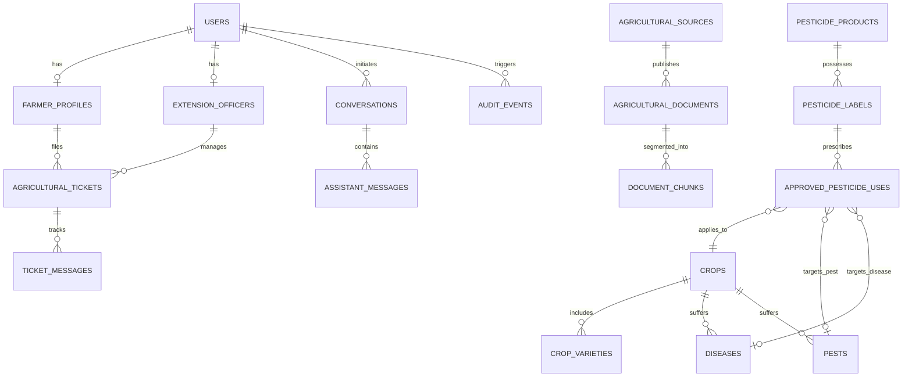

# Bol Kisan: Normalized Database Schema & PostgreSQL Data Architecture

## 1. Schema Overview

The Bol Kisan relational data layer is built on PostgreSQL 16 with the `pgvector` extension for semantic vector retrieval and `uuid-ossp` for secure identifier generation. The schema is normalized (3NF) to guarantee transactional integrity, audit compliance, and strict version control over government agricultural pesticide labels.



---

## 2. Table Definitions & Constraints

### 2.1 Identity & User Management

```sql
CREATE EXTENSION IF NOT EXISTS "uuid-ossp";
CREATE EXTENSION IF NOT EXISTS "pgcrypto";
CREATE EXTENSION IF NOT EXISTS "vector";

-- Enum types
CREATE TYPE user_role AS ENUM ('farmer', 'extension_officer', 'admin');
CREATE TYPE preferred_language AS ENUM ('te', 'hi', 'en');
CREATE TYPE ticket_status AS ENUM ('open', 'triaged', 'under_review', 'resolved', 'closed');
CREATE TYPE ticket_priority AS ENUM ('low', 'medium', 'high', 'emergency');
CREATE TYPE message_type AS ENUM ('text', 'audio', 'image', 'prescription');
CREATE TYPE toxicity_band AS ENUM ('red_extremely_toxic', 'yellow_highly_toxic', 'blue_moderately_toxic', 'green_slightly_toxic');

-- 1. USERS
CREATE TABLE users (
    id UUID PRIMARY KEY DEFAULT gen_random_uuid(),
    phone_number VARCHAR(15) UNIQUE NOT NULL,
    full_name VARCHAR(120) NOT NULL,
    role user_role NOT NULL DEFAULT 'farmer',
    preferred_lang preferred_language NOT NULL DEFAULT 'te',
    is_active BOOLEAN NOT NULL DEFAULT TRUE,
    is_verified BOOLEAN NOT NULL DEFAULT FALSE,
    created_at TIMESTAMPTZ NOT NULL DEFAULT NOW(),
    updated_at TIMESTAMPTZ NOT NULL DEFAULT NOW()
);
CREATE INDEX idx_users_phone ON users(phone_number);
CREATE INDEX idx_users_role ON users(role);

-- 2. FARMER_PROFILES
CREATE TABLE farmer_profiles (
    id UUID PRIMARY KEY DEFAULT gen_random_uuid(),
    user_id UUID UNIQUE NOT NULL REFERENCES users(id) ON DELETE CASCADE,
    state VARCHAR(60) NOT NULL,
    district VARCHAR(60) NOT NULL,
    mandal VARCHAR(60) NOT NULL,
    village VARCHAR(80) NOT NULL,
    pincode VARCHAR(10),
    latitude NUMERIC(9, 6),
    longitude NUMERIC(9, 6),
    land_size_acres NUMERIC(5, 2) DEFAULT 0.0,
    soil_type VARCHAR(50),
    irrigation_source VARCHAR(50),
    created_at TIMESTAMPTZ NOT NULL DEFAULT NOW(),
    updated_at TIMESTAMPTZ NOT NULL DEFAULT NOW()
);
CREATE INDEX idx_farmer_location ON farmer_profiles(state, district, mandal);

-- 3. EXTENSION_OFFICERS
CREATE TABLE extension_officers (
    id UUID PRIMARY KEY DEFAULT gen_random_uuid(),
    user_id UUID UNIQUE NOT NULL REFERENCES users(id) ON DELETE CASCADE,
    officer_code VARCHAR(30) UNIQUE NOT NULL,
    designation VARCHAR(80) NOT NULL,
    department VARCHAR(100) NOT NULL,
    assigned_state VARCHAR(60) NOT NULL,
    assigned_district VARCHAR(60) NOT NULL,
    assigned_mandals TEXT[] NOT NULL,
    verified_by_admin_id UUID REFERENCES users(id),
    verified_at TIMESTAMPTZ,
    created_at TIMESTAMPTZ NOT NULL DEFAULT NOW()
);
CREATE INDEX idx_officer_jurisdiction ON extension_officers(assigned_state, assigned_district);
```

### 2.2 Agricultural Domain & Pest/Pesticide Governance

```sql
-- 4. CROPS
CREATE TABLE crops (
    id UUID PRIMARY KEY DEFAULT gen_random_uuid(),
    scientific_name VARCHAR(120) NOT NULL,
    name_en VARCHAR(80) NOT NULL,
    name_te VARCHAR(80) NOT NULL,
    name_hi VARCHAR(80) NOT NULL,
    category VARCHAR(50) NOT NULL,
    season VARCHAR(30),
    is_active BOOLEAN NOT NULL DEFAULT TRUE,
    created_at TIMESTAMPTZ NOT NULL DEFAULT NOW()
);
CREATE INDEX idx_crops_name_en ON crops(name_en);
CREATE INDEX idx_crops_name_te ON crops(name_te);
CREATE INDEX idx_crops_name_hi ON crops(name_hi);

-- 5. CROP_VARIETIES
CREATE TABLE crop_varieties (
    id UUID PRIMARY KEY DEFAULT gen_random_uuid(),
    crop_id UUID NOT NULL REFERENCES crops(id) ON DELETE CASCADE,
    variety_name VARCHAR(100) NOT NULL,
    duration_days INTEGER,
    recommended_regions TEXT[],
    yield_potential_quintals NUMERIC(5, 2),
    created_at TIMESTAMPTZ NOT NULL DEFAULT NOW()
);

-- 6. DISEASES
CREATE TABLE diseases (
    id UUID PRIMARY KEY DEFAULT gen_random_uuid(),
    crop_id UUID NOT NULL REFERENCES crops(id) ON DELETE CASCADE,
    name_en VARCHAR(100) NOT NULL,
    name_te VARCHAR(100) NOT NULL,
    name_hi VARCHAR(100) NOT NULL,
    pathogen_type VARCHAR(50) NOT NULL,
    symptoms_description TEXT NOT NULL,
    favorable_weather_conditions TEXT,
    created_at TIMESTAMPTZ NOT NULL DEFAULT NOW()
);
CREATE INDEX idx_diseases_crop ON diseases(crop_id);

-- 7. PESTS
CREATE TABLE pests (
    id UUID PRIMARY KEY DEFAULT gen_random_uuid(),
    crop_id UUID NOT NULL REFERENCES crops(id) ON DELETE CASCADE,
    name_en VARCHAR(100) NOT NULL,
    name_te VARCHAR(100) NOT NULL,
    name_hi VARCHAR(100) NOT NULL,
    scientific_name VARCHAR(120),
    economic_threshold_level TEXT,
    damage_symptoms TEXT NOT NULL,
    created_at TIMESTAMPTZ NOT NULL DEFAULT NOW()
);
CREATE INDEX idx_pests_crop ON pests(crop_id);

-- 8. PESTICIDE_PRODUCTS
CREATE TABLE pesticide_products (
    id UUID PRIMARY KEY DEFAULT gen_random_uuid(),
    trade_name VARCHAR(120) NOT NULL,
    manufacturer VARCHAR(120) NOT NULL,
    registration_number VARCHAR(80) UNIQUE NOT NULL,
    formulation_type VARCHAR(30) NOT NULL,
    toxicity toxicity_band NOT NULL,
    cibrc_status VARCHAR(40) NOT NULL DEFAULT 'approved',
    antidote_statement TEXT,
    created_at TIMESTAMPTZ NOT NULL DEFAULT NOW()
);
CREATE INDEX idx_pesticide_trade_name ON pesticide_products(trade_name);

-- 9. PESTICIDE_LABELS
CREATE TABLE pesticide_labels (
    id UUID PRIMARY KEY DEFAULT gen_random_uuid(),
    product_id UUID NOT NULL REFERENCES pesticide_products(id) ON DELETE CASCADE,
    active_ingredient VARCHAR(150) NOT NULL,
    concentration VARCHAR(50) NOT NULL,
    cibrc_approval_number VARCHAR(100) NOT NULL,
    version_number INTEGER NOT NULL DEFAULT 1,
    approval_date DATE NOT NULL,
    official_leaflet_url TEXT,
    is_current_valid BOOLEAN NOT NULL DEFAULT TRUE,
    created_at TIMESTAMPTZ NOT NULL DEFAULT NOW()
);
CREATE INDEX idx_labels_active_ingredient ON pesticide_labels(active_ingredient);

-- 10. APPROVED_PESTICIDE_USES (Crucial Deterministic Safety Matrix)
CREATE TABLE approved_pesticide_uses (
    id UUID PRIMARY KEY DEFAULT gen_random_uuid(),
    label_id UUID NOT NULL REFERENCES pesticide_labels(id) ON DELETE CASCADE,
    crop_id UUID NOT NULL REFERENCES crops(id) ON DELETE CASCADE,
    pest_id UUID REFERENCES pests(id) ON DELETE SET NULL,
    disease_id UUID REFERENCES diseases(id) ON DELETE SET NULL,
    dosage_per_hectare VARCHAR(60) NOT NULL,
    dosage_per_acre VARCHAR(60) NOT NULL,
    dilution_water_liters VARCHAR(60) NOT NULL,
    pre_harvest_interval_days INTEGER NOT NULL,
    max_applications_per_season INTEGER,
    application_method VARCHAR(80) NOT NULL DEFAULT 'Foliar Spray',
    safety_precautions TEXT NOT NULL,
    verification_status VARCHAR(30) NOT NULL DEFAULT 'verified',
    created_at TIMESTAMPTZ NOT NULL DEFAULT NOW()
);
CREATE INDEX idx_approved_uses_lookup ON approved_pesticide_uses(crop_id, pest_id, disease_id);
```

### 2.3 Knowledge Base Collections & Vector Store

```sql
-- 11. AGRICULTURAL_SOURCES
CREATE TABLE agricultural_sources (
    id UUID PRIMARY KEY DEFAULT gen_random_uuid(),
    organization_name VARCHAR(120) NOT NULL,
    source_type VARCHAR(50) NOT NULL,
    official_url TEXT NOT NULL,
    trust_score NUMERIC(3, 2) NOT NULL DEFAULT 1.00,
    created_at TIMESTAMPTZ NOT NULL DEFAULT NOW()
);

-- 12. AGRICULTURAL_DOCUMENTS
CREATE TABLE agricultural_documents (
    id UUID PRIMARY KEY DEFAULT gen_random_uuid(),
    source_id UUID NOT NULL REFERENCES agricultural_sources(id) ON DELETE RESTRICT,
    collection_id VARCHAR(10) NOT NULL, -- KB01 to KB23
    title VARCHAR(255) NOT NULL,
    document_version VARCHAR(30) NOT NULL DEFAULT '1.0',
    publication_date DATE,
    last_verified_at TIMESTAMPTZ NOT NULL DEFAULT NOW(),
    applicable_crop_id UUID REFERENCES crops(id),
    applicable_region VARCHAR(100),
    language preferred_language NOT NULL,
    validity_status VARCHAR(30) NOT NULL DEFAULT 'valid',
    verification_status VARCHAR(30) NOT NULL DEFAULT 'verified',
    original_checksum VARCHAR(64) NOT NULL,
    file_path TEXT NOT NULL,
    created_at TIMESTAMPTZ NOT NULL DEFAULT NOW()
);
CREATE INDEX idx_docs_collection ON agricultural_documents(collection_id);

-- 13. DOCUMENT_CHUNKS (pgvector embeddings & text search)
CREATE TABLE document_chunks (
    id UUID PRIMARY KEY DEFAULT gen_random_uuid(),
    document_id UUID NOT NULL REFERENCES agricultural_documents(id) ON DELETE CASCADE,
    chunk_index INTEGER NOT NULL,
    chunk_text TEXT NOT NULL,
    chunk_language preferred_language NOT NULL,
    tsv_content TSVECTOR GENERATED ALWAYS AS (to_tsvector('english', chunk_text)) STORED,
    embedding VECTOR(768), -- Default 768-dim embeddings (Gemini/IndicBERT compatible)
    metadata_json JSONB NOT NULL DEFAULT '{}'::jsonb,
    created_at TIMESTAMPTZ NOT NULL DEFAULT NOW()
);
CREATE INDEX idx_chunks_tsv ON document_chunks USING GIN(tsv_content);
CREATE INDEX idx_chunks_embedding ON document_chunks USING ivfflat (embedding vector_cosine_ops) WITH (lists = 100);
```

### 2.4 Tickets, Voice Interactions & Audit Logging

```sql
-- 14. AGRICULTURAL_TICKETS
CREATE TABLE agricultural_tickets (
    id UUID PRIMARY KEY DEFAULT gen_random_uuid(),
    ticket_number VARCHAR(24) UNIQUE NOT NULL,
    farmer_id UUID NOT NULL REFERENCES users(id) ON DELETE CASCADE,
    assigned_officer_id UUID REFERENCES users(id) ON DELETE SET NULL,
    crop_id UUID REFERENCES crops(id),
    state VARCHAR(60) NOT NULL,
    district VARCHAR(60) NOT NULL,
    mandal VARCHAR(60) NOT NULL,
    status ticket_status NOT NULL DEFAULT 'open',
    priority ticket_priority NOT NULL DEFAULT 'medium',
    escalation_reason TEXT NOT NULL,
    original_question_transcript TEXT NOT NULL,
    audio_recording_url TEXT,
    attached_image_urls TEXT[],
    resolution_prescription TEXT,
    resolved_at TIMESTAMPTZ,
    created_at TIMESTAMPTZ NOT NULL DEFAULT NOW(),
    updated_at TIMESTAMPTZ NOT NULL DEFAULT NOW()
);
CREATE INDEX idx_tickets_mandal_status ON agricultural_tickets(mandal, status);
CREATE INDEX idx_tickets_farmer ON agricultural_tickets(farmer_id);
CREATE INDEX idx_tickets_officer ON agricultural_tickets(assigned_officer_id);

-- 15. TICKET_MESSAGES
CREATE TABLE ticket_messages (
    id UUID PRIMARY KEY DEFAULT gen_random_uuid(),
    ticket_id UUID NOT NULL REFERENCES agricultural_tickets(id) ON DELETE CASCADE,
    sender_id UUID NOT NULL REFERENCES users(id) ON DELETE CASCADE,
    msg_type message_type NOT NULL DEFAULT 'text',
    content TEXT NOT NULL,
    media_url TEXT,
    created_at TIMESTAMPTZ NOT NULL DEFAULT NOW()
);
CREATE INDEX idx_ticket_messages ON ticket_messages(ticket_id);

-- 16. CONVERSATIONS
CREATE TABLE conversations (
    id UUID PRIMARY KEY DEFAULT gen_random_uuid(),
    user_id UUID NOT NULL REFERENCES users(id) ON DELETE CASCADE,
    session_token VARCHAR(64) UNIQUE NOT NULL,
    language preferred_language NOT NULL DEFAULT 'te',
    started_at TIMESTAMPTZ NOT NULL DEFAULT NOW(),
    last_active_at TIMESTAMPTZ NOT NULL DEFAULT NOW()
);

-- 17. ASSISTANT_MESSAGES
CREATE TABLE assistant_messages (
    id UUID PRIMARY KEY DEFAULT gen_random_uuid(),
    conversation_id UUID NOT NULL REFERENCES conversations(id) ON DELETE CASCADE,
    sender_role VARCHAR(20) NOT NULL, -- 'farmer', 'assistant', 'system'
    transcript TEXT,
    response_text TEXT,
    audio_url TEXT,
    retrieved_chunk_ids UUID[],
    safety_status VARCHAR(30) NOT NULL DEFAULT 'verified',
    confidence_score NUMERIC(3, 2) DEFAULT 0.00,
    created_at TIMESTAMPTZ NOT NULL DEFAULT NOW()
);

-- 18. AUDIT_EVENTS
CREATE TABLE audit_events (
    id UUID PRIMARY KEY DEFAULT gen_random_uuid(),
    event_type VARCHAR(60) NOT NULL,
    actor_id UUID REFERENCES users(id) ON DELETE SET NULL,
    target_entity VARCHAR(60) NOT NULL,
    target_id UUID,
    details_json JSONB NOT NULL DEFAULT '{}'::jsonb,
    ip_address VARCHAR(45),
    created_at TIMESTAMPTZ NOT NULL DEFAULT NOW()
);
CREATE INDEX idx_audit_event_type ON audit_events(event_type);
```

---

## 3. Row-Level Security (RLS) Policies

1. **Farmers**: Can only read and update their own farmer profile and view tickets created by their `user_id`.
2. **Extension Officers**: Can view tickets and farmer profiles within their assigned `assigned_mandals` or `assigned_district`.
3. **Pesticide Labels & Knowledge Chunks**: Read-only for all public authenticated users. Modification restricted to verified Agricultural Scientists / Admins with write audit logging.
