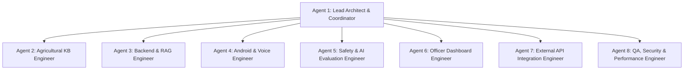

# Bol Kisan: Remaining Implementation Roadmap & Multi-Agent Execution Plan

**Document Version:** 1.0.0  
**Date:** 2026-11-08  
**Scope:** Full Product Implementation across 8 Specialized Agents and 9 Development Priorities  
**Author:** Agent 1 (Lead Software Architect & Engineering Coordinator)

---

## 1. Multi-Agent Team Structure & Shared Contracts

### Team Responsibilities & File Boundaries

| Agent ID | Agent Role | Primary Ownership Boundaries | Dependencies |
|---|---|---|---|
| **Agent 1** | Lead Architect / Coordinator | System design, API contracts, cross-agent integration, final validation, docs | None (Orchestrator) |
| **Agent 2** | Knowledge Base Engineer | `knowledge-base/` (KB01–KB23), ingestion pipeline, data schemas, source audits | ICAR, CIBRC datasets |
| **Agent 3** | Backend & RAG Engineer | `backend/app/ai/`, `backend/app/api/v1/endpoints/voice.py`, `query.py`, RAG index | Agent 2 (KB), Agent 5 (Safety) |
| **Agent 4** | Android & Voice Engineer | `apps/farmer-android/`, Room offline cache, CameraX photo upload, WorkManager | Agent 3 (API contracts) |
| **Agent 5** | Safety & AI Evaluation Engineer | `backend/app/safety/`, pesticide rules, banned chemical scanner, escalation logic | CIBRC registries |
| **Agent 6** | Extension Officer Dashboard Engineer | `apps/officer-dashboard/`, ticket triage, case details, prescription dispatch | Agent 3 (API contracts) |
| **Agent 7** | External API Integration Engineer | `backend/app/integrations/` (IMD weather, Agmarknet mandi, Officer directory) | IMD, Agmarknet schemas |
| **Agent 8** | QA, Security & Performance Engineer | `backend/tests/`, security audit, performance benchmarks, regression testing | All agents |

---

## 2. Priority Milestones Execution Schedule

### Milestone 1: Knowledge Base Foundation & Ingestion (Priority 1)
- **Assigned:** Agent 2 (KB Engineer)
- **Deliverables:**
  - Populate structured, verified JSON files for KB01 through KB23 covering cereals, pulses, oilseeds, commercial crops, and vegetables.
  - Ingestion script with SHA-256 integrity validation and metadata catalog.
  - Update `knowledge-base/metadata/kb_registry.json`.
- **Acceptance:** All 23 collections exist with verified, non-empty records attributed to official sources.

### Milestone 2: Safety Gate Hardening & Banned Chemical Protection (Priority 3)
- **Assigned:** Agent 5 (Safety Engineer)
- **Deliverables:**
  - Expand `PesticideValidator` with comprehensive CIBRC active ingredients and approved crops.
  - Add explicit blacklist for banned/restricted chemicals (e.g. Endosulfan, Monocrotophos on vegetables, Paraquat).
  - Strengthen post-LLM regex scanner to catch rogue dosage numbers or unapproved tank mixes.
- **Acceptance:** 100% block rate on unapproved chemical queries with automatic escalation ticket generation.

### Milestone 3: Dynamic Weather & Mandi API Integrations (Priority 6)
- **Assigned:** Agent 7 (API Integration Engineer)
- **Deliverables:**
  - Implement `backend/app/integrations/weather.py` (IMD district agromet advisories).
  - Implement `backend/app/integrations/mandi.py` (Agmarknet APMC modal prices).
  - Integrate endpoints `/api/v1/weather` and `/api/v1/mandi` into FastAPI router.
- **Acceptance:** API endpoints return formatted, localized weather and commodity prices with source timestamps.

### Milestone 4: Backend RAG Engine & Multilingual Voice Pipeline (Priority 2)
- **Assigned:** Agent 3 (Backend & RAG Engineer)
- **Deliverables:**
  - Upgrade `RAGService` to search across all 23 collections with hybrid dense + keyword search.
  - Multilingual voice query workflow: Language identification -> Intent classification -> Verified knowledge retrieval -> Gemini 3.8 Flash synthesis -> Safety validation -> Spoken response.
  - Implement multi-modal leaf disease diagnosis endpoint `/api/v1/disease/diagnose`.
- **Acceptance:** Verified voice and disease query workflows returning grounded answers with citations.

### Milestone 5: Officer Web Dashboard Refinement (Priority 4)
- **Assigned:** Agent 6 (Officer Dashboard Engineer)
- **Deliverables:**
  - Wire disease image preview into ticket detail view.
  - Add audio waveform and playback for farmer voice transcripts.
  - Implement instant prescription builder with CIBRC dosage validation helper for extension officers.
  - Connect live API polling and status updates.
- **Acceptance:** Full officer triage, prescription generation, and resolution loop working with real backend.

### Milestone 6: Android App Integration & Offline Knowledge Sync (Priority 5, 7, 8)
- **Assigned:** Agent 4 (Android & Voice Engineer)
- **Deliverables:**
  - Connect CameraX photo capture to `/api/v1/disease/diagnose` via Retrofit multipart upload.
  - Seed Room SQLite local database with offline knowledge cards for primary crops (Rice, Cotton, Chilli, Tomato, Wheat, Maize).
  - Ensure fail-safe fallback to Room DB on offline/low-connectivity conditions.
- **Acceptance:** Android project compiles cleanly into debug APK with zero build errors.

### Milestone 7: Comprehensive QA, Security Audit & Performance Benchmarking (Priority 9)
- **Assigned:** Agent 8 (QA Engineer) & Agent 1 (Lead Architect)
- **Deliverables:**
  - Comprehensive Pytest regression suite covering auth, safety, RAG, tickets, weather, mandi, and disease APIs.
  - Security review (OWASP, RBAC boundaries, input sanitization, secret management).
  - Performance and memory benchmark documentation (`docs/performance-report.md`, `docs/security-report.md`).
  - Consolidated subagent execution report (`docs/subagent-execution-report.md`).
- **Acceptance:** All tests pass; all documentation artifacts updated and finalized.