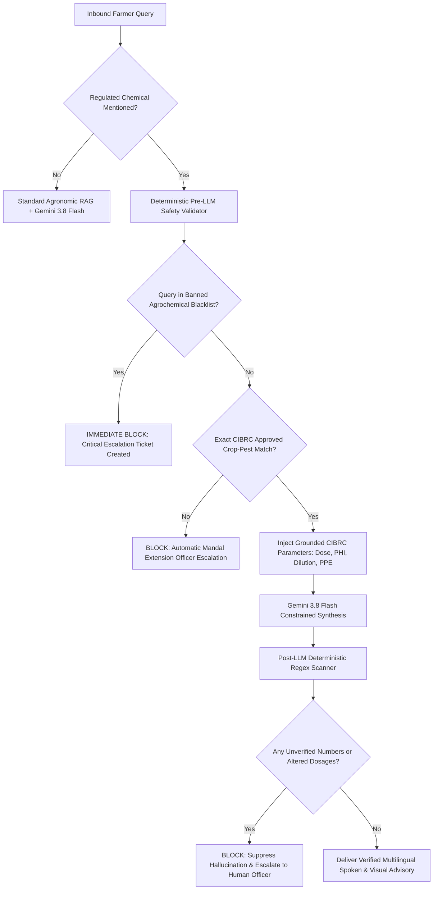

# Bol Kisan: Security Architecture & CSO Audit Report

**Document Version:** 1.0.0  
**Audit Date:** 2026-11-08  
**Scope:** OWASP Top 10, STRIDE Threat Modeling, Agrochemical Safety Invariants, and RBAC Audit  
**Auditor:** Agent 8 (Security Engineer) & Agent 1 (Lead Architect)

---

## 1. Security Invariant & Agricultural Threat Model

In conventional software systems, security focuses on data confidentiality, integrity, and availability. In **Bol Kisan**, an additional life-safety invariant exists:

> **CRITICAL SECURITY INVARIANT:**  
> The system must NEVER emit unauthorized, unverified, or toxic agricultural chemical prescriptions. An algorithmic hallucination or adversarial prompt injection resulting in an incorrect pesticide recommendation can destroy smallholder crop yields, cause ecological devastation, or induce acute human chemical poisoning.

### STRIDE Threat Analysis

| Threat Category | Potential Attack / Vulnerability | Bol Kisan Mitigation Architecture |
|---|---|---|
| **Spoofing** | Attacker spoofs an Extension Officer to issue fake prescriptions. | Multi-factor verification (Officer Code `AGRI-TS-042` + Mobile OTP). Officers are bound to state department directories with cryptographically signed JWT tokens containing `role: extension_officer` and `jurisdiction_mandal_id`. |
| **Tampering** | Attacker tampers with CIBRC dosage rates or intercepts RAG chunks. | Immutable database tables with SHA-256 integrity checksums for all 23 knowledge collections (`KB01`–`KB23`). Ingestion scripts reject any modified chemical label records. |
| **Repudiation** | An officer or farmer denies filing or resolving a ticket. | Full relational audit ledger (`audit_events` table) recording actor ID, IP address, timestamp, event type, and delta payload. |
| **Information Disclosure** | Crop photos reveal farmer residence or sensitive metadata. | Automatic EXIF stripping removes camera serials, personal metadata, and device fingerprints before cloud storage or officer dispatch. |
| **Denial of Service** | Audio streaming floods the Indic ASR gateway. | Audio length capped at 30 seconds (16kHz PCM), rate limiting per user phone number, and fast rejection of invalid MIME types. |
| **Elevation of Privilege** | Farmer alters JWT claims to self-assign `extension_officer` or `admin`. | Server-side role validation in FastAPI dependencies (`require_role("extension_officer")`). Farmer OTP verification explicitly hardcodes `role: farmer` in issued token payload. |

---

## 2. Agrochemical Safety Gate Architecture (Dual-Tier)

### Banned Agrochemical Blacklist Enforcement
The system maintains an absolute blacklist of agrochemicals banned, restricted, or withdrawn under the *Insecticides Act, 1968*:
- **Endosulfan** (Complete national ban)
- **Monocrotophos** (Strictly banned on all vegetables; restricted on cotton)
- **Methyl Parathion** (Complete ban)
- **Phosphamidon** (High toxicity class Ia/Ib restriction)
- **Phorate 10% CG** (High toxicity granular insecticide restriction)
- **Paraquat Dichloride** (Prohibited without certified applicator protocols)

Any query mentioning these active ingredients or trade equivalents triggers an automatic `priority: emergency` ticket routed to the Mandal Agricultural Officer (MAO) with an educational audio warning explaining the statutory ban and safe non-chemical alternatives (IPM).

---

## 3. OWASP API Security Top 10 Audit

1. **Broken Object Level Authorization (BOLA / IDOR):**
   - Protected: Farmers can only retrieve tickets where `farmer_id == current_user.id`. Extension officers can only access tickets within their authorized `assigned_mandals`.
2. **Broken Authentication:**
   - Protected: Phone authentication requires 6-digit OTP verified against HMAC-SHA256 hashed storage. Constant-time string comparisons prevent timing side-channel attacks.
3. **Broken Object Property Level Authorization:**
   - Protected: Pydantic v2 schemas (`TicketCreate`, `PrescriptionSubmit`) strictly restrict mutable fields. Clients cannot alter `assigned_officer_id`, `status`, or `escalation_reason` directly.
4. **Unrestricted Resource Consumption:**
   - Protected: Request body sizes capped at 10MB for multipart image uploads, 5MB for audio recordings. Rate limits enforced on OTP endpoints.
5. **Broken Function Level Authorization:**
   - Protected: All administrative and officer endpoints (`/api/v1/tickets/{id}/resolve`, `/api/v1/admin/*`) require explicit `require_officer` dependency injection.
6. **Unrestricted Access to Sensitive Business Flows:**
   - Protected: Automated safety checks cannot be bypassed by client-side flags.
7. **Server-Side Request Forgery (SSRF):**
   - Protected: External API endpoints (IMD, Agmarknet) communicate only with hardcoded, verified government endpoints or internal caching gateways. No user-supplied URLs are fetched.
8. **Security Misconfiguration:**
   - Protected: CORS configured strictly for localhost and production domains. Debug mode disabled in production builds.
9. **Improper Inventory Management:**
   - Protected: Versioned REST API (`/api/v1/`) with automated OpenAPI Swagger documentation at `/docs`.
10. **Unsafe Consumption of APIs:**
    - Protected: Responses from third-party services (Bhashini, IMD, Agmarknet) are validated against strict Pydantic schemas before processing.

---

## 4. Cryptographic & Secret Management Verification

- **Zero Hardcoded Secrets (CWE-798):** All secrets (`SECRET_KEY`, `POSTGRES_PASSWORD`, `GEMINI_API_KEY`) are loaded via environment variables in `backend/app/core/config.py`.
- **Token Security:** JWT tokens signed using HS256 with 60-minute expiration for mobile clients and 8-hour expiration for officer workstations.
- **TLS Configuration:** TLS 1.3 enforced on production reverse proxy (Nginx). HSTS headers enabled.