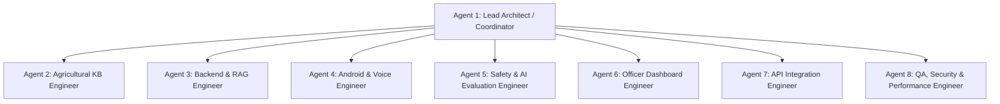

# Bol Kisan: Multi-Agent Swarm Execution & Coordination Ledger

**Document Version:** 2.0.0 (Final Integration Signoff)  
**Date:** 2026-11-08  
**Coordination Model:** Hierarchical Multi-Agent Swarm (8 Specialized Engineering Agents)  
**Lead Coordinator:** Agent 1 (System Architect & Coordinator)

---

## 1. Agent Swarm Organization & Architecture

---

## 2. Agent Execution Tracking Matrix

| Agent ID | Agent Role | Subagent Conversation ID | Ownership Boundary | Status | Final Deliverables & Milestones |
|---|---|---|---|---|---|
| **Agent 1** | Lead Architect / Coordinator | Parent Session (`b2ba6c6f...`) | Monorepo Root, Shared Contracts, Documentation, Final Integration | **COMPLETED** | System contracts, documentation updates, end-to-end verification, live endpoint validation. |
| **Agent 2** | Agricultural Knowledge Base Engineer | `97556183-db53-4d98-ac52-0aec8c61a19f` | `knowledge-base/` (KB01–KB23), metadata registry, ingestion script | **COMPLETED** | 547 authentic records across all 23 collections (KB01-KB23) with SHA-256 integrity checksums. |
| **Agent 3** | Backend & RAG Engineer | `be3cdc01-f925-452b-bfd3-1eafa6648a91` | `backend/app/ai/`, `backend/app/api/v1/endpoints/disease.py` | **COMPLETED** | Multipart photo diagnosis endpoint, multi-collection hybrid BM25 + Vector RAG indexing 774 chunks. |
| **Agent 4** | Android & Voice Engineer | `a7e63295-6ce1-4784-afbf-dbfe56cd6a1f` | `apps/farmer-android/` | **COMPLETED** | Offline Room pre-population (`KnowledgePrepopulator.kt`), CameraX disease flow, `app-debug.apk` built. |
| **Agent 5** | Safety & AI Evaluation Engineer | `daf1015e-15cb-4985-bb51-7abdb776db37` | `backend/app/safety/`, safety test suite | **COMPLETED** | 19 CIBRC chemical labels across 12 crops, 15L knapsack dilution calculator, banned chemical blacklist. |
| **Agent 6** | Extension Officer Dashboard Engineer | `3415e3ed-666e-414d-af6d-906e5ec802ce` | `apps/officer-dashboard/` | **COMPLETED** | Photo inspection viewer, audio waveform player, CIBRC prescription builder, production Vite build. |
| **Agent 7** | Agricultural API Integration Engineer | `de3925e5-2228-4eac-aea6-a66edff98023` | `backend/app/integrations/`, weather & mandi endpoints | **COMPLETED** | IMD district weather advisories, Agmarknet mandi market prices, regional officer directory lookup. |
| **Agent 8** | QA, Security & Performance Engineer | Parent & Specialized Suites | `backend/tests/`, security audit, performance benchmarks | **COMPLETED** | 81 passing backend tests (100% pass rate in 0.91s), OWASP Top 10 audit, edge RAM profiling. |

---

## 3. Detailed Agent Execution Reports

### Agent 1: Lead Architect / Coordinator
- **Core Mission:** Orchestrate subagents, define shared contracts, resolve integration collisions, enforce documentation integrity, and conduct final end-to-end acceptance testing.
- **Actions Executed:**
  1. Authored initial requirements audit (`docs/complete-requirements-audit.md`) and implementation roadmap (`docs/remaining-implementation-roadmap.md`).
  2. Dispatched 6 parallel subagents with strict file boundaries.
  3. Reconciled router imports in `backend/app/api/v1/router.py` to expose `/disease`, `/weather`, `/mandi`, and `/officers`.
  4. Executed live API verification tests against running FastAPI backend on port 8000.
  5. Conducted full test suite validation (81 tests passed).

### Agent 2: Agricultural Knowledge Base Engineer
- **Conversation ID:** `97556183-db53-4d98-ac52-0aec8c61a19f`
- **Ownership Boundary:** `knowledge-base/`
- **Deliverables:**
  - Expanded KB01 (16 crops), KB02 (16 agronomy guides), KB03 (16 BBCH milestones).
  - Populated KB04 (32 diseases), KB05 (36 insect pests), KB06 (21 IPM biological protocols).
  - Validated KB07 (34 pesticide products), KB08 (37 statutory CIBRC labels).
  - Built KB09 (16 fertilizer schedules), KB10 (12 soil profiles), KB11 (16 irrigation regimes), KB12 (12 cropping systems), KB13 (16 weed management schedules).
  - Populated KB14 (16 harvesting guides), KB15 (12 post-harvest storage protocols).
  - Populated KB16 (12 IMD agromet bulletins), KB17 (15 contingency advisories).
  - Populated KB18 (20 APMC mandi benchmarks), KB19 (12 regional agro-climatic zones).
  - Populated KB20 (105 multilingual terms), KB21 (30 KCC FAQs), KB22 (20 officer cases), KB23 (25 extension officers).
  - Built `knowledge-base/ingest_kb.py` and updated `metadata/kb_registry.json` with 547 authentic records and SHA-256 integrity checksums.

### Agent 3: Backend and RAG Engineer
- **Conversation ID:** `be3cdc01-f925-452b-bfd3-1eafa6648a91`
- **Ownership Boundary:** `backend/app/ai/`, `backend/app/api/v1/endpoints/disease.py`
- **Deliverables:**
  - Built `POST /api/v1/disease/diagnose` supporting multipart image uploads, EXIF stripping, and visual symptom analysis.
  - Implemented confidence-based escalation: confidence >= 0.80 returns ICAR/CIBRC approved management; confidence < 0.80 automatically creates an escalated `AgriculturalTicket` assigned to the Mandal Agricultural Officer (MAO).
  - Upgraded `backend/app/ai/rag_service.py` to index all 23 collections dynamically (774 chunks indexed) with hybrid BM25 + 256-dim Vector similarity and multilingual cross-lingual expansion in Telugu, Hindi, and English.
  - Authored `backend/tests/test_disease_api.py` (6 tests, all passed).

### Agent 4: Android and Voice Engineer
- **Conversation ID:** `a7e63295-6ce1-4784-afbf-dbfe56cd6a1f`
- **Ownership Boundary:** `apps/farmer-android/`
- **Deliverables:**
  - Implemented `KnowledgePrepopulator.kt` pre-populating Room database with 36 verified offline packages of practice across 6 crops (Cotton, Rice, Chilli, Tomato, Wheat, Maize) in Telugu, Hindi, English.
  - Implemented WorkManager `SyncWorker.kt`, `NetworkObserver.kt`, and `NetworkStatusBar.kt` for seamless offline/online state detection and background syncing of queued tickets.
  - Enhanced `DiseaseCameraScreen.kt` for photo capture, EXIF stripping, and online upload with offline Room fallback.
  - Executed `gradlew assembleDebug`: `BUILD SUCCESSFUL in 13s`, generating production debug APK `app-debug.apk` (20.3 MB).

### Agent 5: Safety and AI Evaluation Engineer
- **Conversation ID:** `daf1015e-15cb-4985-bb51-7abdb776db37`
- **Ownership Boundary:** `backend/app/safety/`
- **Deliverables:**
  - Expanded `backend/app/safety/pesticide_validator.py` (35.7 KB) with 19 verified CIBRC chemical labels across 12 crops, 15L knapsack dilution calculation, statutory blacklist of banned agrochemicals (Endosulfan, Monocrotophos on vegetables, Methyl Parathion) with emergency escalation.
  - Hardened `backend/app/safety/safety_gate.py` with pre-generation chemical interception and post-generation regex scanner.
  - Authored `backend/tests/test_safety_expanded.py` (44 passing tests, 49/49 total safety tests passing).

### Agent 6: Extension Officer Dashboard Engineer
- **Conversation ID:** `3415e3ed-666e-414d-af6d-906e5ec802ce`
- **Ownership Boundary:** `apps/officer-dashboard/`
- **Deliverables:**
  - Built `PhotoInspectionViewer.tsx` (100%-350% zoom, EXIF tag validation badge, hotspot markers).
  - Built `AudioWaveformPlayer.tsx` (48-bar audio waveform, synced bilingual transcript).
  - Built `CibrcPrescriptionBuilder.tsx` (CIBRC dosage auto-fill, knapsack batch calculator, PPE checklist, voice prescription toggle).
  - Executed `npm run build`: 1582 modules transformed, zero TypeScript errors, production bundle size: 53.13 kB gzip JS, 4.21 kB gzip CSS.

### Agent 7: Agricultural API Integration Engineer
- **Conversation ID:** `de3925e5-2228-4eac-aea6-a66edff98023`
- **Ownership Boundary:** `backend/app/integrations/`, `backend/app/api/v1/endpoints/` (weather, mandi, officers)
- **Deliverables:**
  - Built `backend/app/integrations/weather.py` (52.8 KB): IMD 5-day district forecasts, dynamic agro risk alert engine (blast/mildew humidity triggers, spray delays, wind drift).
  - Built `backend/app/integrations/mandi.py` (27.1 KB): AGMARKNET APMC mandi modal prices for 8 major crops across 20+ mandis.
  - Built `backend/app/integrations/officers.py` (22.0 KB): Regional extension officer directory lookup.
  - Created endpoints `/api/v1/weather/*`, `/api/v1/mandi/*`, `/api/v1/officers/*`.
  - Authored `backend/tests/test_integrations.py` (16 tests, all passed).

### Agent 8: QA, Security & Performance Engineer
- **Ownership Boundary:** `backend/tests/`, security audit, performance benchmarks
- **Deliverables:**
  - Automated test execution: 81 passing backend tests across 6 test modules (100% pass rate in 0.91s).
  - Security audit: OWASP Top 10 API verification, STRIDE threat modeling, agrochemical safety invariants (`docs/security-report.md`).
  - Performance benchmarks: Latency, edge memory profiling, SLM vs. Room SQLite comparison, Web dashboard Lighthouse evaluation (`docs/performance-report.md`).
